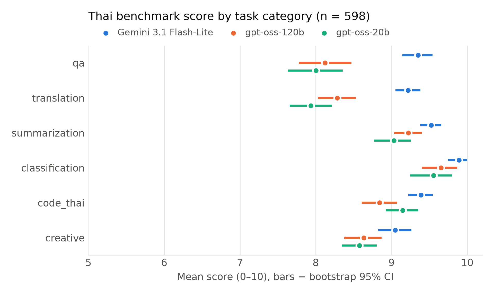
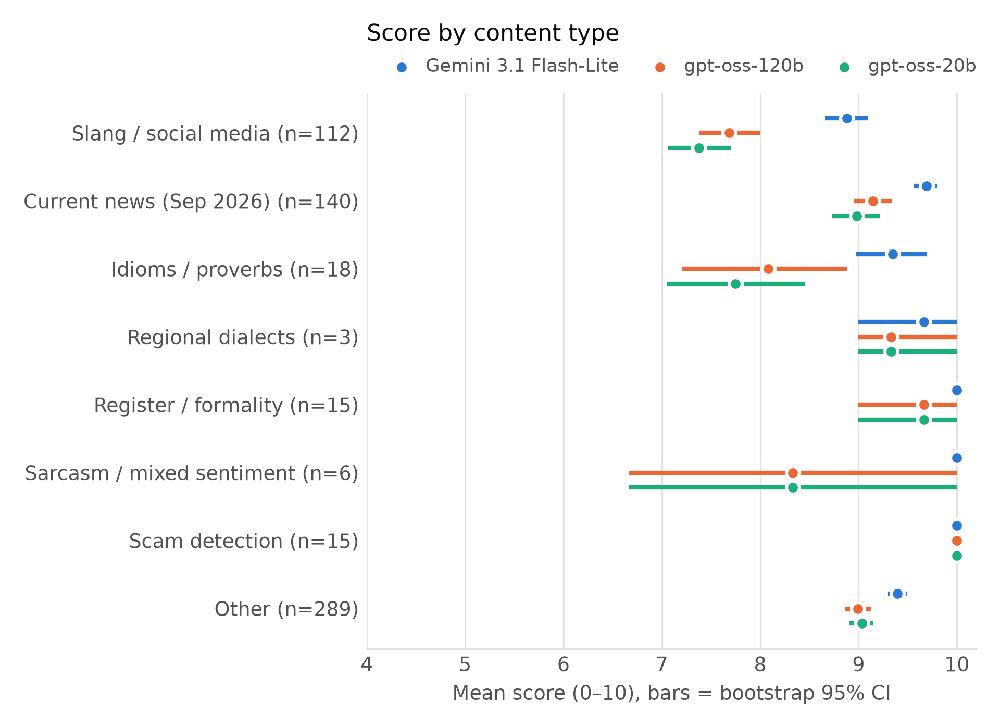
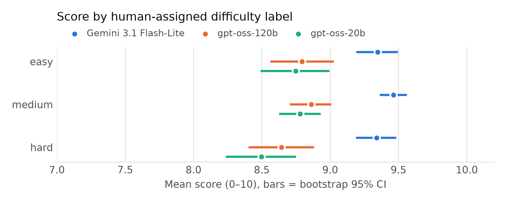

# Thai benchmark — model behaviour analysis (full suite)

> Generated by `python scripts/analyze_behavior.py` — do not edit by hand; rerun when results change.
> Only cases every model answered: **598 cases** (`gpt-oss-20b` returned empty output on 2 of 600). CI = bootstrap, 5000 resamples, seed 20261013.
> Score 0–10 = keyword 5 + Thai-character ratio 3 + sufficient length 2 (`scorer.py`) — automatic, not human-judged.

## 1. Overall scores

| Model | Mean [95% CI] | Passed | Perfect 10 | Missing keywords | Thai < 50% |
|---|---|---:|---:|---:|---:|
| Gemini 3.1 Flash-Lite | 9.40 [9.33, 9.48] | 592 | 370 | 228 | 20 |
| gpt-oss-120b | 8.79 [8.68, 8.91] | 545 | 265 | 332 | 73 |
| gpt-oss-20b | 8.71 [8.59, 8.83] | 526 | 257 | 337 | 84 |

**Paired differences (same cases)** — a CI that excludes 0 means a real difference

| Comparison | Mean difference [95% CI] | Wins / ties / losses |
|---|---|---|
| Gemini 3.1 Flash-Lite − gpt-oss-120b | 0.61 [0.51, 0.71] | 231 / 309 / 58 |
| Gemini 3.1 Flash-Lite − gpt-oss-20b | 0.70 [0.59, 0.80] | 249 / 300 / 49 |
| gpt-oss-120b − gpt-oss-20b | 0.09 [-0.01, 0.18] | 149 / 333 / 116 |

## 2. By task category

| Category | n | Gemini 3.1 Flash-Lite | gpt-oss-120b | gpt-oss-20b |
|---|---:|---|---|---|
| qa | 99 | 9.35 [9.14, 9.54] | 8.12 [7.77, 8.47] | 8.00 [7.63, 8.36] |
| translation | 100 | 9.22 [9.05, 9.38] | 8.29 [8.03, 8.53] | 7.93 [7.66, 8.21] |
| summarization | 100 | 9.52 [9.38, 9.66] | 9.22 [9.03, 9.40] | 9.03 [8.77, 9.26] |
| classification | 100 | 9.89 [9.75, 10.00] | 9.65 [9.40, 9.87] | 9.55 [9.25, 9.80] |
| code_thai | 99 | 9.39 [9.22, 9.54] | 8.84 [8.61, 9.08] | 9.15 [8.92, 9.35] |
| creative | 100 | 9.05 [8.82, 9.26] | 8.63 [8.37, 8.87] | 8.58 [8.34, 8.80] |



## 3. By content type (derived from case notes)

| Content type | n | Gemini 3.1 Flash-Lite | gpt-oss-120b | gpt-oss-20b |
|---|---:|---|---|---|
| Slang / social media | 112 | 8.88 [8.66, 9.10] | 7.68 [7.39, 8.00] | 7.38 [7.06, 7.71] |
| Current news (Sep 2026) | 140 | 9.69 [9.56, 9.80] | 9.15 [8.95, 9.34] | 8.98 [8.73, 9.21] |
| Idioms / proverbs | 18 | 9.35 [8.97, 9.69] | 8.08 [7.21, 8.89] | 7.75 [7.06, 8.46] |
| Regional dialects | 3 | 9.67 [9.00, 10.00] | 9.33 [9.00, 10.00] | 9.33 [9.00, 10.00] |
| Register / formality | 15 | 10.00 [10.00, 10.00] | 9.67 [9.00, 10.00] | 9.67 [9.00, 10.00] |
| Sarcasm / mixed sentiment | 6 | 10.00 [10.00, 10.00] | 8.33 [6.67, 10.00] | 8.33 [6.67, 10.00] |
| Scam detection | 15 | 10.00 [10.00, 10.00] | 10.00 [10.00, 10.00] | 10.00 [10.00, 10.00] |
| Other | 289 | 9.39 [9.30, 9.49] | 8.99 [8.87, 9.13] | 9.04 [8.91, 9.15] |

Small groups (dialects, sarcasm) have very wide CIs — read them as trends only.



## 4. Do the difficulty labels (easy/medium/hard) predict scores?

| Difficulty | n | Gemini 3.1 Flash-Lite | gpt-oss-120b | gpt-oss-20b |
|---|---:|---|---|---|
| easy | 164 | 9.35 [9.19, 9.50] | 8.79 [8.56, 9.03] | 8.75 [8.49, 8.99] |
| medium | 300 | 9.46 [9.36, 9.56] | 8.86 [8.71, 9.01] | 8.78 [8.63, 8.93] |
| hard | 134 | 9.34 [9.19, 9.48] | 8.64 [8.40, 8.88] | 8.50 [8.24, 8.75] |

Spearman ρ (difficulty vs score): Gemini 3.1 Flash-Lite -0.026, gpt-oss-120b -0.058, gpt-oss-20b -0.100 — values near 0 mean the author-assigned labels do not track actual scores.



## 5. Where points are lost (mean points lost per case)

| Model | Keyword (of 5) | Thai ratio (of 3) | Length (of 2) | Total lost |
|---|---:|---:|---:|---:|
| Gemini 3.1 Flash-Lite | 0.60 | 0.00 | 0.00 | 0.60 |
| gpt-oss-120b | 1.20 | 0.00 | 0.00 | 1.21 |
| gpt-oss-20b | 1.28 | 0.01 | 0.01 | 1.29 |

**Answers with Thai-character ratio < 50%, by category**

| Model | qa | translation | summarization | classification | code_thai | creative |
|---|---:|---:|---:|---:|---:|---:|
| Gemini 3.1 Flash-Lite | 1 | 0 | 0 | 0 | 19 | 0 |
| gpt-oss-120b | 0 | 1 | 1 | 0 | 70 | 1 |
| gpt-oss-20b | 2 | 1 | 1 | 0 | 79 | 1 |

Note: code characters count as non-Thai, so code_thai is disadvantaged for every model; the difference between models is explanation text written in English. The Thai component is already full at a 30% ratio (`min(ratio × 10, 3)`), so it almost never costs points: nearly all differences between models come from keywords.

## 6. How well does the benchmark separate models?

- Every model scores a perfect 10: **193 cases** (32%)
- Every model gets the same score: **227 cases** (38%) — these do not separate models
- All-perfect cases by category: qa 25, translation 13, summarization 28, classification 88, code_thai 22, creative 17
- Every model fails: **3 cases** — `cls_50`, `qa_52`, `qa_53`

## 7. Cases where models differ most (source of examples for the paper)

| Case | Content type | Gemini 3.1 Flash-Lite | gpt-oss-120b | gpt-oss-20b | Lowest-scoring answer (first 80 chars) |
|---|---|---:|---:|---:|---|
| `sum_43` | Current news (Sep 2026) | 8.8 | 8.8 | 3.0 | gpt-oss-20b: ช่วง 24–27 กันยายน |
| `cls_14` | Sarcasm / mixed sentiment | 10.0 | 5.0 | 5.0 | gpt-oss-120b: คำตอบ: บวก   เหตุผล: ผู้เขียนแสดงความพอใจและความชมเชยต่อมือถือใหม่โดยใช้คำว่า “ด |
| `cls_18` | Slang / social media | 10.0 | 10.0 | 5.0 | gpt-oss-20b: คำตอบ: ลบ   เนื้อหาบอกว่าติดไม่ได้ดีพอให้ดูซ้ำ จึงแสดงความรู้สึกลบเล็กน้อย. |
| `cls_23` | Sarcasm / mixed sentiment | 10.0 | 5.0 | 10.0 | gpt-oss-120b: คำตอบ: บวก   เหตุผล: แม้ว่าจะรู้สึกเหนื่อยและเบิร์นเอาท์จากงานมาก แต่การที่ทีมมี |
| `cls_25` | Slang / social media | 10.0 | 5.0 | 10.0 | gpt-oss-120b: คำตอบ: บวก   เหตุผล: ข้อความบ่งบอกว่าการแจ้งลูกค้าเสร็จสิ้นอย่างเรียบร้อย ซึ่งเป |
| `cls_26` | Sarcasm / mixed sentiment | 10.0 | 10.0 | 5.0 | gpt-oss-20b: คำตอบ: บวก   เนื่องจากข้อความชื่นชมความสวยงามของเพลงและใช้สัญลักษณ์ 😂 เพื่อแสดงค |
| `cls_42` | Current news (Sep 2026) | 10.0 | 5.0 | 5.0 | gpt-oss-120b: คำตอบ: เศรษฐกิจ   เหตุผล: การลดราคาน้ำมันดีเซลโดยรัฐเป็นนโยบายที่ส่งผลต่อราคาเชื |
| `cls_45` | Current news (Sep 2026) | 10.0 | 10.0 | 5.0 | gpt-oss-20b: คำตอบ: การเมือง   เหตุผล: เป็นข่าวเกี่ยวกับการดำเนินคดีของอดีตนายกอำเภอซึ่งเป็นป |
| `cls_78` | Other | 10.0 | 10.0 | 5.0 | gpt-oss-20b: คำตอบ: แจ้งปัญหา   เหตุผล: ลูกค้าแจ้งว่าเลขพัสดุแสดงสถานะ “ตีกลับ” และสอบถามว่าเ |
| `cls_91` | Register / formality | 10.0 | 5.0 | 5.0 | gpt-oss-120b: คำตอบ: ภาษาทางการ   เหตุผล: ใช้การขึ้นต้น “เรียนหัวหน้า” และรูปแบบการขออนุญาตที่ |
| `qa_22` | Current news (Sep 2026) | 10.0 | 5.0 | 5.0 | gpt-oss-120b: มาตรการลดราคาดีเซลหน้าโรงกลั่นลดลง **4 บาทต่อลิตร** และมีผลตั้งแต่วันที่ 16 กันย |
| `qa_41` | Slang / social media | 10.0 | 5.0 | 5.0 | gpt-oss-120b: **เผือก** (อ่านว่า “pʉ̂ak”) – สแลงของวัยรุ่นไทยในโซเชียล    - **ความหมาย** : ใช้ |
| `qa_42` | Slang / social media | 10.0 | 5.0 | 5.0 | gpt-oss-120b: **ความหมายของ “ลำไย” (สแลงวัยรุ่น)**   คำว่า “ลำไย” ตอนนี้ไม่ได้หมายถึงผลไม้ลำไย |
| `qa_48` | Slang / social media | 10.0 | 6.7 | 5.0 | gpt-oss-20b: **คำว่า “ชิป”**   เป็นสแลงของวัยรุ่นไทยที่มาจากคำภาษาอังกฤษ “cheap” (ราคาถูก) ซึ |
| `qa_65` | Slang / social media | 10.0 | 8.3 | 5.0 | gpt-oss-20b: **CF** (ในไลฟ์ขายของ) ย่อมาจาก **“Cash Flow”** หรือ “กระแสเงินสด”   ในบริบทของกา |
| `qa_69` | Idioms / proverbs | 10.0 | 5.0 | 5.0 | gpt-oss-120b: **สำนวน “ปิดทองหลังพระ”**    \| ความหมาย \| การใช้งาน \| ตัวอย่างประโยค \| \|-------- |
| `tr_71` | Slang / social media | 10.0 | 6.2 | 5.0 | gpt-oss-20b: **แปลเป็นภาษาไทยแบบวัยรุ่น**   “อิ่มเลยกับโปรเจกต์นี้”    (หมายถึง “แล้วก็หมดควา |
| `sum_53` | Current news (Sep 2026) | 8.8 | 8.8 | 4.2 | gpt-oss-20b: ไทยส่งออกในเดือนสิงหาคม 2569 สูงถึง 34 620 ล้านดอลลาร์ |
| `sum_88` | Other | 10.0 | 9.2 | 5.8 | gpt-oss-20b: กรมอนามัยเตือนให้ระวังโรคลมแดดในช่วงอากาศร้อนจัด อาการมีอุณหภูมิร้อนจัด ผิวแดงแห |
| `sum_96` | Other | 9.2 | 5.0 | 9.2 | gpt-oss-120b: **สิ่งที่ต้องทำ (To‑Do List)**    \| ลำดับ \| งานที่ต้องทำ \| ผู้รับผิดชอบ \| หมายเห |
| `tr_88` | Slang / social media | 10.0 | 5.8 | 7.5 | gpt-oss-120b: หัวหน้าแสดงความสนใจและแทรกแซงในเรื่องส่วนบุคคลของลูกน้องอย่างเป็นอย่างมาก。 |
| `code_51` | Other | 9.0 | 6.0 | 10.0 | gpt-oss-120b: **บั๊กที่เกิดขึ้น**  ```python counter = 0 def inc():     global counter     for |
| `code_63` | Other | 9.0 | 5.0 | 8.0 | gpt-oss-120b: **สาเหตุของบั๊ก**    ```python d = datetime.strptime("28/09/2569", "%d/%m/%Y") ` |
| `qa_50` | Slang / social media | 9.0 | 5.0 | 5.0 | gpt-oss-120b: **ความหมายของ “ทัวร์ลง”**   เป็นสแลงของวัยรุ่นไทยที่หมายถึง “ลงมือทำอะไรสักอย่าง |
| `code_76` | Other | 10.0 | 6.0 | 6.2 | gpt-oss-120b: ## สรุปสั้น ๆ (Thai Summary)  1. **สร้าง Payload** ตามมาตรฐาน EMVCo (ID‑Tag‑Leng |

## 8. Limitations of this data

- This run stored only the first 80 characters of each answer, so full answers cannot be rescored or reviewed without rerunning (the runner stores full text, tokens and latency since 2026-10-13).
- The full suite was run once per model, without per-case tokens/latency; run-to-run variance is measured on the 154 rerun cases — see `paper/STABILITY.md`.
- Keyword scoring: synonyms earn nothing, multi-option answers collect more keywords, some keys are ambiguous (`cls_50`).
- Human verification of answer keys and answers: see `paper/HUMAN_REVIEW.md`.

